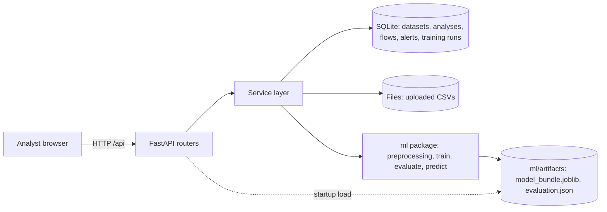
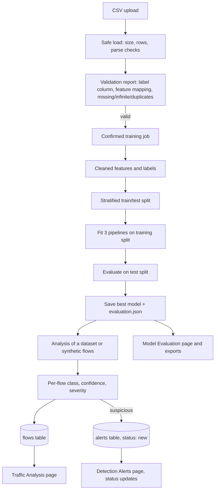

# Architecture

## Components
| Layer | Technology | Responsibility |
|-------|------------|----------------|
| Frontend | React, Vite, TypeScript, Tailwind, Recharts | Six pages; all data comes from the REST API |
| API | FastAPI, Pydantic | Validation, error mapping, thin routers |
| Services | Plain Python (`backend/app/services`) | Dataset import, training jobs, analyses, alerts, exports |
| Storage | SQLite (standard library) + files | Metadata, flows, alerts, jobs in SQLite; uploaded CSVs and model files on disk |
| ML | pandas, NumPy, scikit-learn, joblib (`ml/`) | Validation, cleaning, training, evaluation, inference |

The ML package has no dependency on the web layer, so it can be run from the command line
(`python -m ml.train`) and tested on its own.

## System architecture


## Data flow


## Key design decisions
- **Flow records, not packets.** Keeps the project safe, offline and reproducible.
- **Services separate from routers.** Logic is testable without a web server.
- **Training in a background thread.** One job at a time; progress is stored in SQLite so the UI can poll.
  Jobs interrupted by a restart are marked failed on startup.
- **Model bundle stores the feature list.** Inference refuses records that lack required features instead
  of guessing.
- **Server-generated file names.** Uploaded file names are display-only, so a client cannot choose a path.
- **Parameterised SQL and whitelisted sort columns.** Search and filter text is treated as data.
- **Honest labelling.** Synthetic data, unverified predictions and uncalibrated probabilities are labelled
  wherever they appear.

## Repository layout
```
ml/            preprocessing, training, evaluation, inference, synthetic generator, feature schema
backend/app/   api (routers), services, schemas, database, core
backend/tests/ ML, service and HTTP tests
frontend/src/  pages, layouts, components, services, hooks, types, utils
docs/          this documentation set
datasets/      place real datasets here (ignored by Git)
```
