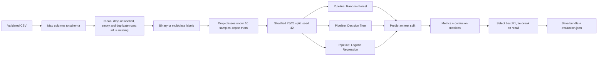

# Model Methodology

## ML workflow

## Training
| Model | Settings | Preprocessing inside the pipeline |
|-------|----------|-----------------------------------|
| Random Forest | 150 trees, `balanced_subsample` class weights | Median imputation |
| Decision Tree | max depth 12, `balanced` class weights | Median imputation |
| Logistic Regression | up to 2000 iterations, `balanced` class weights | Median imputation, signed log transform, standard scaling |

- All learned steps are fitted on the training split only (scikit-learn `Pipeline`).
- The split is stratified with a fixed seed (42), so results are reproducible for a given dataset and
  library version. A test checks that two runs give identical metrics.
- The signed log transform tames heavy-tailed values such as bytes per second for Logistic Regression.
- No hyperparameter search is performed; settings are fixed and documented above.
- Classes with fewer than 10 samples are excluded and listed in the evaluation, because they cannot be
  split or evaluated reliably.

## Modes
- **Multiclass:** the actual labels in the dataset (Normal plus each attack type present). The model can
  only predict attack types it saw in training.
- **Binary:** every non-Normal label becomes `Suspicious`. Use it when attack categories are sparse.

## Evaluation
All metrics come from predictions on the held-out test split.
| Metric | Meaning |
|--------|---------|
| Accuracy | Share of test flows classified correctly. Misleading when one class dominates |
| Precision | Of flows flagged as a class, the share that truly belonged to it (false alarms lower it) |
| Recall | Of flows truly in a class, the share found (missed attacks lower it) |
| F1 | Harmonic mean of precision and recall |
| Headline averaging | Binary: the `Suspicious` class. Multiclass: macro average (every class counts equally) |
| Normal flows flagged | Share of normal test flows predicted as suspicious: the false positive rate that costs analyst time |
| Per-class FPR | One-vs-rest false positive rate for each class |

Missed attacks (low recall) and false alarms (high false positive rate) both have operational cost, and
accuracy can look excellent on an imbalanced dataset while a rare attack is almost never detected.
That is why recall, the false positive rate and the per-class table are shown next to accuracy.

## Model selection
The model with the highest headline F1 is saved and loaded for analysis; ties are broken on recall.
Selection uses the same test split that is reported, with no separate validation split, so the selected
model's score is slightly optimistic. See limitations.

## Prediction confidence and severity
- **Confidence** is the model's probability for the predicted class. It is not calibrated and does not
  confirm an intrusion. The interface says so wherever it is shown.
- **Severity** is assigned from the predicted label by a fixed rule (not from confidence):
  High for labels containing dos, ddos, bot, infiltration, heartbleed or sql injection; Medium for any other
  attack label including binary `Suspicious`; None for Normal.

## Example result (SYNTHETIC data, not a benchmark)
Run on `ml/data/sample_synthetic_flows.csv` (3,015 rows, 3,000 after removing 15 duplicates; 2,250 train and 750 test).
The data was generated from rules we wrote, with some label overlap, so these numbers describe the
generator and say nothing about real-world detection.

| Mode | Model | Accuracy | Precision | Recall | F1 | Normal flagged |
|------|-------|----------|-----------|--------|----|----------------|
| Multiclass | Random Forest (selected) | 0.9813 | 0.9925 | 0.9644 | 0.9779 | 0.0000 |
| Multiclass | Decision Tree | 0.9667 | 0.9623 | 0.9583 | 0.9601 | 0.0244 |
| Multiclass | Logistic Regression | 0.9720 | 0.9733 | 0.9605 | 0.9666 | 0.0156 |
| Binary | Random Forest (selected) | 0.9827 | 1.0000 | 0.9567 | 0.9779 | 0.0000 |
| Binary | Decision Tree | 0.9693 | 0.9695 | 0.9533 | 0.9613 | 0.0200 |
| Binary | Logistic Regression | 0.9707 | 0.9696 | 0.9567 | 0.9631 | 0.0200 |

Results on a real dataset have not been produced in the build environment and are not claimed here.
